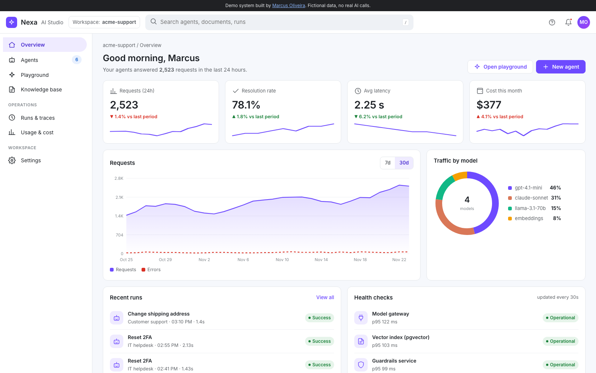

# Nexa AI Studio

Console to build, test and monitor AI agents that answer from a company's own documents (RAG).

**Live demo:** https://marcusolive.github.io/nexa-ai-studio/

> Portfolio project by [Marcus Oliveira](https://marcusolive.github.io). All data is fictional and no real AI provider is called: the console simulates retrieval, generation and costs in the browser.



## What it shows

| Area | What you can do |
|---|---|
| Overview | KPIs with sparklines, requests vs errors chart (7d/30d), traffic by model, recent runs and health checks |
| Agents | Sortable and filterable table, agent detail with system prompt, pause/activate, create a new agent |
| Playground | Ask questions and get a streamed, grounded answer with citations and a step-by-step trace (guardrails, embedding, retrieval, generation, output check) |
| Knowledge base | Documents per knowledge base, chunk counts, upload with indexing progress, stale document detection |
| Runs & traces | Every run with latency, tokens and cost, filters, trace detail and CSV export |
| Usage & cost | Budget progress, end-of-month forecast, daily cost and cost per agent |
| Settings | Masked API keys, one-time key reveal, guardrail and privacy switches |

## Stack

- HTML5, CSS3 and vanilla JavaScript (ES2020), no build step and no dependencies
- Shared UI kit (`assets/css/kit.css`, `assets/js/kit.js`): layout shell, SVG charts, data table, modal and toast
- Responsive down to mobile, keyboard shortcut `/` for search, `Esc` closes dialogs, ARIA roles on dialogs and switches

## Project structure

```
index.html            page shell and views
assets/css/kit.css    shared design system (console layout, cards, tables, charts)
assets/css/app.css    product-specific styles (chat, trace, switches)
assets/js/kit.js      UI kit: icons, charts, table, modal, toast, router
assets/js/data.js     fictional, deterministic sample data
assets/js/app.js      screens and interactions
docs/SPEC.md          functional specification and acceptance criteria
```

## Run locally

```bash
python3 -m http.server 8080
```

Then open http://localhost:8080. Any static server works.

## How it maps to a real system

In production this console would sit on top of:

- An agent API (.NET or Python) that orchestrates guardrails, retrieval and the LLM call
- A vector store (PostgreSQL + pgvector) exposed through an MCP tool
- Usage events streamed to a database for cost reporting
- SSO and role-based access for the workspace

## License

[MIT](LICENSE)
